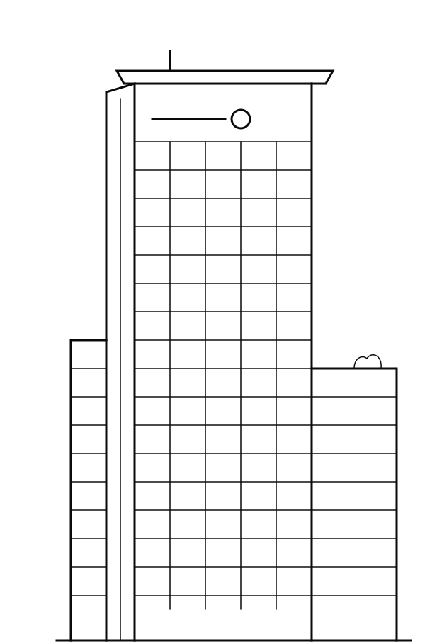

> Este es un artículo de prueba para el blog. Reemplázalo o bórralo cuando publiques el tuyo.

La sección de experiencia muestra cada lugar como un edificio dibujado con líneas que emerge del suelo. Todo ocurre en un solo canvas y cada lugar es solo un SVG más una entrada en un archivo JSON.



## El edificio sube del suelo

El edificio no aparece con una animación lineal. La distancia que le falta para llegar a su lugar se reduce como `altura / t`, así que arranca rápido y frena suavemente al final. Mientras sube, el suelo se rompe y suelta escombros: entre más rápido sube, más escombros salen.

## Un cielo que sigue la hora real

El cielo se calcula con la hora de la Ciudad de México y con el clima real:

- Los colores pasan de noche a amanecer, día y atardecer según la salida y puesta del sol.
- Si está lloviendo, los colores se apagan y cae lluvia sobre el edificio.
- Las líneas del edificio se vuelven claras u oscuras para contrastar con el cielo.

Para probar otra hora se puede abrir la página con `?hora=21` o forzar la lluvia con `?clima=lluvia`.

## Agregar un lugar nuevo

1. Guarda el dibujo del edificio en la carpeta `sprites`.
2. Agrega una entrada al archivo `data/experience.json`.
3. Listo, el badge y la animación se crean solos.

```json
{"image": "gentera.svg", "place": "Gentera", "title": "Gentera", "description": "...", "extra": "..."}
```

---

Puedes volver a la [guía de Markdown](#guia-de-markdown) para ver todo lo que entiende este blog.
